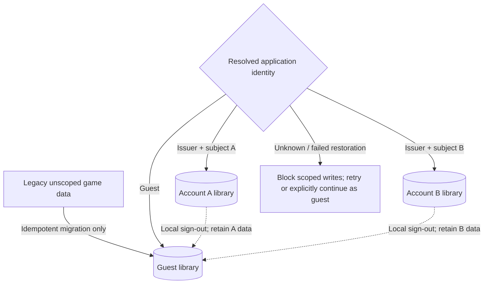

# Game of Life: Player Character identity integration

Status: design proposal only. No application implementation or infrastructure
changes are included.

## Ownership and scope

The shared identity service belongs to the private
[wintermuted/player-character repository](https://github.com/wintermuted/player-character).
Its [canonical shared identity design](https://github.com/wintermuted/player-character/blob/main/docs/shared-identity-mvp.md)
owns the platform comparison, OIDC contract, hosting/local testing, diagrams,
and shared account/session lifecycle requirements.

Player Character will serve Game of Life, Overworld, Inventory, and future
applications with independent business backends. Keycloak versus Better Auth
with its OAuth/OIDC provider plugin remains undecided. This app is a client,
not the home of the identity server or the other applications' business logic.

This document covers only the proposed first Game of Life integration:

- Optional GitHub-backed login through Player Character; Apple later.
- Read-only account profile with real identity, not placeholder account data.
- Guest play stays available without authentication.
- Browser-local libraries separated by guest and signed-in identity; no sync.
- Existing local data remains with guest. New accounts start empty.
- No automatic guest copy/upload or email-based account linking.
- Warn before leaving unsaved work; reset the active board on identity changes.

The [backend discovery plan](2026-08-06-backend-discovery-scope-lock.md) remains
the future server-owned data/sync roadmap. This narrower identity-first slice
does not implement its reconciliation, migration/backfill, or cloud persistence.

## Application authentication boundary

Use an established OIDC client with authorization code + S256 PKCE as a public
SPA client. Register separate development/production clients with exact callback
and allowed-origin configuration. No client secret belongs in the browser.

Identify users by issuer + subject, not email, GitHub username, display name, or
a profile slug. The shared service defines its subject policy; future issuer
changes require migration, not an automatic new local identity.

Keep tokens in memory rather than board storage/localStorage. Session restoration
may require a top-level OIDC redirect; central SSO can avoid another GitHub prompt.
Do not depend on third-party iframe cookies. Process the registered Pages
base-path-root callback before normal routing and remove temporary parameters.
Missing configuration leaves guest play available and disables sign-in explicitly.

Represent loading, guest, authenticated, and error states separately. Failure to
restore a session must not silently select guest and permit wrong-scope writes.
Provide retry or explicit guest choice.

Local "Sign out" clears this app's session, returns to guest, and retains account
library data. It does not claim to end the central SSO session, other apps'
sessions, or GitHub access. Global logout and explicit account switching follow
the shared service's separately documented policy.

## Browser-local library contract

- Version keys and scope boards, names, favorites, recents, forks, local profile
  preferences, and seed markers by guest or an unambiguous issuer/subject encoding.
- Migrate legacy local/session storage to guest only, idempotently; preserve
  destination data and mark completion only after successful writes.
- Keep built-in patterns separate from saved libraries. Do not seed fabricated
  saved boards, favorites, or social data into new account libraries.
- Theme/language and the local/session mode selector stay device preferences.
  Mode changes and clearing data affect only the active library, not identity
  credentials, other libraries, or the shared account.
- Scope determines local ownership and favorite membership; names are attribution.
- After confirmed identity changes, pause/reset the board and clear account
  caches. Capture scope for pending work so stale effects cannot cross accounts.
- Canceling the unsaved-work warning keeps the board/session unchanged.
  Forced expiration/sign-out blocks old-scope writes immediately; retain unsaved
  work only as a detached in-memory draft for discard/export, never automatic
  saving into the next identity's library.

Label libraries as saved in this browser for this account; explicitly state
that sign-in does not sync boards. Local separation is not encryption or a
security boundary against someone controlling the same browser profile.

## Repository touchpoints

- `packages/api/src/`: minimal account/session contract, OIDC integration,
  scoped library helpers/migration, and exports. No identity server here.
- `packages/app/src/index.tsx` and `app/App.tsx`: session initialization,
  callback handling, and guest/account navigation above scoped consumers.
- `Profile.tsx`: real account versus guest versus clearly labeled demo creators;
  no private library/email leakage into demo/public-like routes.
- `SignOut.tsx` and `Settings.tsx`: real local logout, explicit errors, and
  active-library storage operations.
- Explore/playground helpers: stable-identity attribution, account transitions,
  unsaved-work handling, and stale-effect isolation.
- Translations, deployment workflow, and README: honest local-only messaging,
  public issuer/client configuration, exact callbacks, and preview restrictions.

UI libraries remain presentational; core simulation stays independent. Reuse
theme components and split large files rather than grow controllers.

## Implementation prerequisites and verification

Select/configure Player Character first; implement scoped storage independently.
Both are prerequisites for wiring app authentication. No platform provisioning,
runtime implementation, or other-repository migration is part of this proposal.

Focused tests must cover guest/A/B separation, idempotent migration, clear/mode
operations, name changes, stale writes, and forced session loss. Configured OIDC
tests cover callback validation, first/repeat login, cancel/error, reload, local
logout, account switching, unsaved work, and identity outage. Verify no credentials
or tokens appear in library snapshots, debug output, or retained callback URLs.

Use the shared service's isolated local test setup and development GitHub app.
Production credentials/configuration must not be exposed to untrusted PR previews.
Public account launch also requires the shared lifecycle/privacy/operations
gates. CI owns lint/typecheck/build; this documentation-only PR needs no local
application validation commands.
