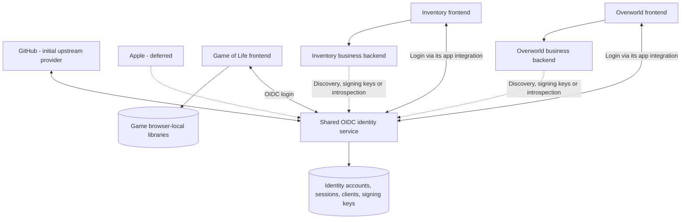
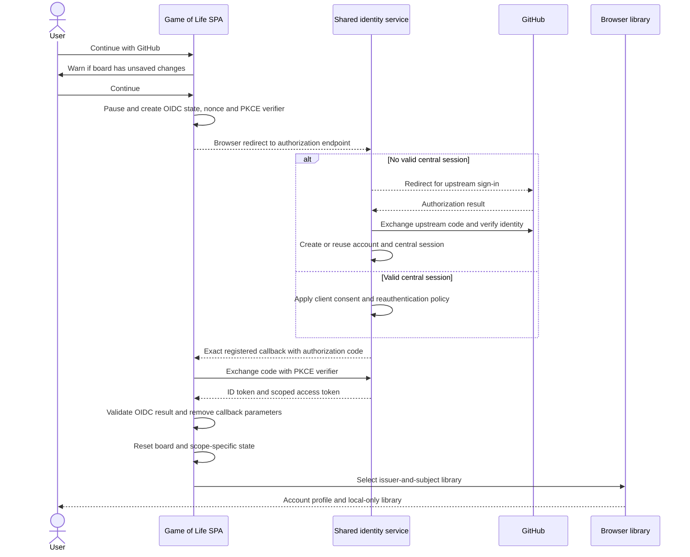
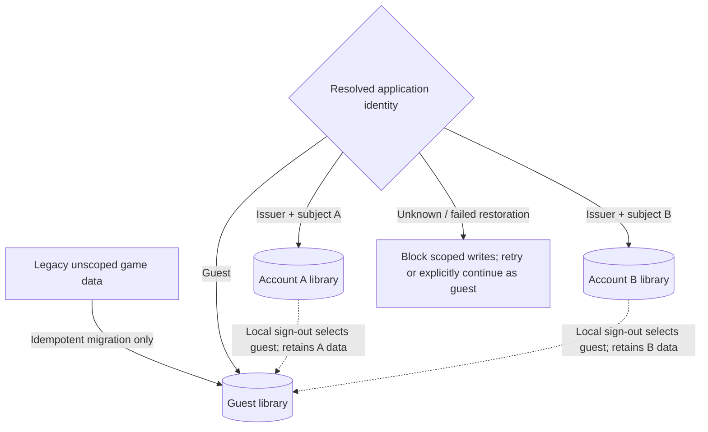
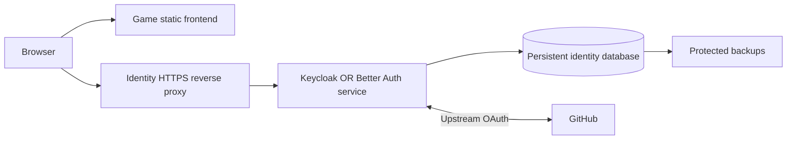

# Shared identity MVP: Game of Life, Overworld, and Inventory

Status: design proposal. No implementation, infrastructure, platform selection,
or migration of another application's authentication is authorized by this doc.

## Goal and scope

Create a standalone identity service usable by Game of Life, Overworld,
Inventory, and future applications with independent business backends.
Applications integrate using OpenID Connect (OIDC), not another application's
cookies, provider tokens, database tables, or internal authentication SDK.

Confirmed decisions:

- Keep the identity platform open; compare self-hosted Keycloak and Better Auth.
- GitHub is the initial upstream identity provider; Apple is deferred.
- Game of Life is the first proposed integration, with optional guest play and
  a read-only account profile.
- Game of Life boards remain local, separated by guest/account. Existing data
  stays with the guest; new accounts start with empty local libraries.
- Warn before leaving unsaved work and reset the board on account changes.
- Do not automatically copy/upload guest data or link accounts by email.

This is a narrower identity-first slice, not a replacement for the future
server-owned data and sync roadmap in
[the backend discovery plan](2026-08-06-backend-discovery-scope-lock.md).
Cloud persistence, reconciliation, and backfill do not ship with this slice.
Other applications' current auth, data, and hosting have not been inspected.

## System boundaries

The other apps' frontend/backend links illustrate the intended boundary, not
verified implementation details. Shared authentication does not share business
data, imply cross-app permissions, or require rewriting domain backends.

| Shared identity service owns | Each application owns |
|---|---|
| Upstream GitHub/Apple credentials and identity connections | Domain-specific profiles and business data |
| Identity accounts, central login session, token issuance | Application session and integration |
| Registered clients, allowed redirects, token audiences | Roles, subscriptions, resource ownership, authorization |
| Signing keys and account lifecycle operations | Mapping authenticated identities to local records |

Use the OIDC issuer plus subject (`iss`, `sub`) as the identity key, never email,
GitHub username, display name, or a local slug. Decide public versus pairwise
subjects explicitly: subjects need not be identical between clients. Any
cross-app correlation must be deliberate, not inferred from matching emails.
Changing issuer/subject policy later requires an explicit migration.

## Platform comparison and decision gate

| Option | Strengths | Work and tradeoffs |
|---|---|---|
| Keycloak | Purpose-built identity server with OIDC, upstream identity brokering, client administration, and session management | Larger runtime and operational footprint; configuration and upgrades still need ownership |
| Better Auth with OAuth Provider plugin | TypeScript-based service assembled from an auth framework; OAuth/OIDC provider support | Own the service shell, login/admin integration, persistence, deployment, and verification of required lifecycle features |

Both have open-source self-hosted options. Neither eliminates infrastructure,
patching, monitoring, backups, or the external GitHub/Apple dependency.
Do not build OAuth/OIDC protocol handling from scratch.

Before implementation, evaluate one minimal prototype per candidate against the
same checks, then record one platform decision:

- GitHub brokering, missing/private email behavior, and no repository permissions.
- Discovery, authorization code with S256 PKCE, strict redirects, and nonce/state
  protection through established OIDC libraries.
- Public SPA and confidential backend clients, API audiences, and scope limits.
- Session expiration, refresh-token rotation/reuse handling where used,
  revocation, key rotation, local logout, and global logout capabilities.
- Account deletion/revocation, backups/restoration, upgrade effort, and license.
- Later Apple support and its secret-renewal requirements.

Supabase/Firebase/Clerk were initial single-app options; they are not assumed
equivalent to a reusable self-hosted OIDC provider. No vendor is selected.

## OIDC integration contract

- One registered client per application and environment; secrets only for
  confidential clients and only in their servers. Browser clients have no secret.
- Exact callback/logout URL allowlists; production credentials never go into
  untrusted PR previews. No open registration or wildcard redirects initially.
- Request `openid` and necessary profile claims only. GitHub email access may
  be required by the chosen implementation; do not request repository access.
- ID tokens establish login identity at the client. Business APIs accept access
  tokens intended for their resource, not ID tokens or upstream GitHub tokens.
- Validate signature, issuer, expiration, and intended audience; validate
  algorithm/key policy and client flow-specific nonce/state as applicable.
- Business APIs enforce their own authorization. A Game of Life token must not
  grant access to Inventory or Overworld APIs.
- Publish standard discovery/JWKS metadata. Use validated cached keys for JWT
  access tokens, or introspection where the selected token model requires it.
- Short token lifetimes bound stale access; offline JWT validation is not
  immediate revocation. Select lifetimes and stronger revocation needs before launch.
- Disable automatic cross-provider account merging by matching email. Require
  authenticated proof before future linking.

Apps with business backends should prefer a same-origin backend-for-frontend
(BFF) or existing backend integration that keeps tokens server-side and issues
Secure, HttpOnly cookies with appropriate SameSite and CSRF controls.
Do not introduce a new BFF into every app without inspecting its existing stack.

Game of Life currently has no backend. Its smallest initial integration can be
a public OIDC SPA client using code + PKCE, short-lived tokens kept in memory,
and explicit top-level sign-in when required. Do not rely on third-party iframe
cookies or persist bearer tokens in board data/localStorage. A reload may require
another top-level redirect, which the central session can often complete
without another GitHub prompt. Guest use remains available if identity is down.

## Sign-in and single sign-on

Established libraries handle the protocol operations; these are not instructions
to hand-code token validation. A later app performs its own OIDC flow, reusing
the identity-service session when policy permits. It receives its own tokens and
app session, not the Game of Life session.

For Game of Life, "Sign out" means end the local app session and select guest.
It does not promise to log the user out of other apps or GitHub. Central/global
logout is a distinct, clearly labeled operation; its precise behavior and support
are platform-selection/launch gates. Back-channel notifications or introspection
may be needed for immediate cross-app invalidation; offline apps cannot observe
it instantly. Make account switching explicit so an existing central session
does not silently sign the user back into the wrong account.

## Game of Life local-library isolation

- Versioned keys scope boards, names, favorites, recents, fork records, local
  profile preferences, and any seed marker to guest or an unambiguous encoding of
  issuer + subject. Storage scope identifiers must not contain tokens or emails.
- Migrate legacy local/session storage to guest only, idempotently and without
  overwriting destination data. Mark completion only after successful writes.
- A new account starts empty; built-in patterns remain separate. Do not inject
  fabricated favorites, saved boards, or social data into account libraries.
- Theme/language and the local/session mode selector remain device preferences.
  Changing storage mode migrates only the active library; clearing active data
  does not clear other libraries, auth state, or the identity account.
- Favorites/ownership use scope, not display-name equality. Historical names are
  attribution, not proof of identity.
- Resolve authentication before mounting scoped data consumers. Unknown/error
  is not guest; provide retry/explicit guest choice.
- Canceling the unsaved-work warning preserves current board/session. Confirmed
  account changes pause/reset the board and clear account-specific view caches.
- Forced expiration/external sign-out immediately blocks old-scope writes.
  Unsaved work may remain as a detached in-memory draft for discard/export, but
  cannot be auto-saved into the next scope. Reset after handling the draft.
- Capture scope for pending work; stale effects cannot write into another account.

This is logical separation, not encryption or protection from someone who
controls the same browser profile. Shared identity does not sync these libraries.

## Hosting and local development

Production needs a stable issuer URL/domain with HTTPS, a server/container host,
durable database, securely managed credentials and signing keys, monitoring,
patching, restart policy, and tested backups. The shared service should be a
separate deployable/repository, not a game API package. Repository name, host,
domains, capacity, and operational owner remain undecided.

Use platform-supported production persistence. Postgres is a sensible shared
service baseline. Better Auth with SQLite and persistent disk can be evaluated
for one instance, but do not assume that is a Keycloak production topology or a
multi-instance design. Choose resources after measuring the selected platform.

Game of Life can remain on GitHub Pages as a public SPA OIDC client. The
identity-service cookie stays on the identity origin and is used by top-level
redirects, not credentialed cross-site application fetches. Browser token exchange
must be supported for exact allowed app origins. A future BFF may warrant
same-origin frontend/backend hosting; unrelated apps need not share cookies.

For Pages, register the actual deployed base-path root as the callback and process
OIDC query parameters before normal routing. Avoid an unserved direct SPA
callback route. Preserve/validate allowed local destinations and remove code/state
from the URL after completion; the identity issuer is not the Pages app URL.

Local test topology:

- Game Vite frontend at `http://localhost:3000`.
- Identity service on a different local port, using the chosen platform's
  development configuration and a separate local database/volume.
- A separate development GitHub OAuth app returns to the identity service's
  platform-specific upstream callback, not the game callback.
- The identity service's registered Game client returns to the Vite root.
- GitHub redirects the browser to localhost; no tunnel is required for this flow.
- Local environment files are ignored. No secrets enter `VITE_*` variables.
- Use local app/BFF/backend processes and isolated databases when testing other
  apps. Docker Compose can make the chosen topology repeatable; do not build both
  platforms into the final runtime.
- Exercise production-like HTTPS/cookies before release. Local development modes
  are not production security configurations.

Do not implement an identity server inside `packages/api`, which currently holds
client-side browser services. Missing identity configuration must leave guest
play available with sign-in explicitly disabled, not fabricated.

## Game of Life integration touchpoints

- `packages/api/src/`: small account/session contract, one OIDC client integration,
  scoped library helpers/migration, and exports. Keep account snapshots minimal:
  issuer, subject, display name, optional avatar/email/account creation date.
- `packages/app/src/index.tsx`: session initialization above scoped consumers.
- `packages/app/src/app/App.tsx`: guest/account actions and callback orchestration.
- `Profile.tsx`: guest versus real account versus clearly labeled demo-creator
  views; no private library/email leakage into demo/public-like routes.
- `SignOut.tsx`: actual local logout and explicit error behavior.
- `Settings.tsx`, Explore, and playground helpers: active-scope operations,
  stable-identity attribution, stale-state isolation, and board-transition guards.
- Translation files: sign-in, read-only profile, local-data notice, and errors.
- Deployment/README: public issuer/client configuration, exact callbacks, and
  preview restrictions. No production client configuration for untrusted previews.

Keep UI libraries presentational and core simulation independent. Use current
theme classes/components and split large files rather than grow controllers.

## Implementation sequence and gates

1. Evaluate Keycloak versus Better Auth; choose one and document client/subject,
   session, token, logout, and production-persistence policies.
2. Create the standalone identity deployment with GitHub, isolated development
   configuration, explicit clients, key management, and lifecycle operations.
3. Implement scoped Game browser storage and guest migration independently.
4. Integrate Game OIDC/session restoration, transitions, profile, and local logout.
5. Verify the protocol and library-isolation contract; document operating procedures.
6. Inspect Overworld and Inventory before planning each integration. Register
   distinct clients/API resources and migrate existing identities explicitly,
   without silently replacing or merging existing accounts.

Identity and storage are prerequisites for Game integration. Platform choice,
deployment, and cross-repository implementation require separate approval.

## Acceptance and testing

- Automated provider-independent tests cover guest/A/B isolation, legacy
  migration, clear/mode operations, display-name changes, and stale-effect guards.
- OIDC tests cover invalid issuer/audience/signature, expired tokens, state/nonce
  mismatch, PKCE failure, redirect rejection, and wrong-resource tokens.
- Use temporary identity databases and mocked upstream responses in automation;
  real GitHub credentials/interactive login are reserved for configured smoke tests.
- Browser smoke tests cover first/repeat login, cancel/error, reload, local logout,
  explicit account switch, unsaved work, identity outage, and session loss.
- Two registered local clients demonstrate central SSO without sharing app
  sessions; a test API rejects another resource's access token. This can be a
  bounded test client without prematurely modifying Overworld or Inventory.
- Verify key rollover, expiry/revocation behavior, backup restoration, HTTPS
  cookie policy, and separation of local versus global logout.
- Private/missing email or profile fields do not fabricate identity. Verify the
  selected platform's supported behavior before promising email-less signup.
- No tokens/secrets in library snapshots, debug output, committed config, or
  retained callback URLs. Restrict any stored upstream tokens to server-side use.
- CI handles lint, typecheck, and builds; do not run those locally. This
  documentation-only PR does not require application validation commands.

Before public account launch, resolve account deletion, retention, privacy
disclosures, incident response, and operational ownership. Deleting a local
library is not deleting a shared identity or another app's business data.

## References

- [Keycloak integration overview](https://www.keycloak.org/securing-apps/overview)
- [Better Auth OAuth/OIDC provider](https://www.better-auth.com/docs/plugins/oauth-provider)
- [Better Auth installation and persistence](https://www.better-auth.com/docs/installation)
- [Better Auth GitHub integration](https://www.better-auth.com/docs/authentication/github)
- [GitHub OAuth authorization](https://docs.github.com/en/apps/oauth-apps/building-oauth-apps/authorizing-oauth-apps)
- [Apple web configuration](https://developer.apple.com/help/account/capabilities/configure-sign-in-with-apple-for-the-web/)
